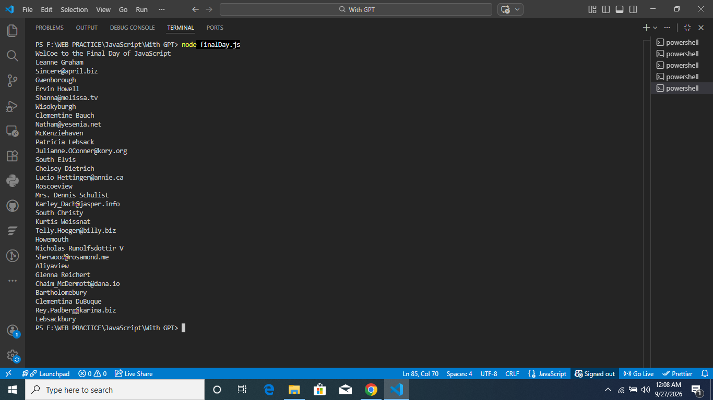

# 🚀 JavaScript for FYP — Learning, Practice & Mini Project

Hands-on JavaScript notes, daily practice files, and a mini project built while preparing the JS foundations needed for my Final Year Project (FYP). Covers everything from array methods to `fetch`, `async/await`, and error handling — ending with a small API-driven mini project.

---

## 📖 About

This repository documents my day-by-day journey learning **Modern JavaScript**, with a focus on the concepts most relevant to a real-world, API-connected FYP (e.g., a Student Admission / Application system). Each file is a lesson: notes in Urdu/English mix (Roman Urdu explanations + English code), practice tasks, and my own solutions — followed by a final mini project that ties everything together.

---

## 🗂️ Repository Structure

```
JS for FYP/
│
├── Day01.js                     # map(), filter(), forEach()
├── Day02.js                     # Template literals, objects with template literals
├── day03.js                     # Callbacks → Promises → async/await → Fetch/APIs
├── day04.js                     # Fetch API (GET/POST/PUT/PATCH/DELETE) + Error Handling
├── finalDay.js                  # ⭐ Mini Project: Student Admission API
│
├── assets/
│   └── final-day-output.png     # Screenshot of the mini project running
│
├── revisionTestDay01.js         # Revision: map/filter/forEach + destructuring
├── revisionTestDay02.js         # Revision: template literals, modules, JSON
├── testing.js                   # Fetch + response.ok error handling practice
├── export.js                    # Modules practice scratch file
│
├── Lesson 05/                   # Modules: named & default export/import practice
│   ├── app.js
│   ├── math.js
│   ├── student.js
│   └── index.html
│
├── Modules Import & Export/     # Core export/import concepts
│   ├── exportFile.js
│   └── importFile.js
│
├── intro.html / intro.js        # DOM basics practice
│
├── RoadMap for FYP.rtf          # Personal learning roadmap
└── Zero to End FYP RoadMap.rtf  # Full roadmap: JS → Node.js → Backend for FYP
```

---

## 🧠 Concepts Covered

- ✅ Array methods — `map()`, `filter()`, `forEach()`
- ✅ Template literals (with variables & objects)
- ✅ Objects, destructuring, spread/rest
- ✅ Modules — named exports, default exports, import/export
- ✅ JSON — `JSON.stringify()` / `JSON.parse()`
- ✅ Callbacks
- ✅ Promises
- ✅ `async` / `await`
- ✅ Fetch API — `GET`, `POST`, `PUT`, `PATCH`, `DELETE`
- ✅ Error Handling — `try / catch / finally`, `throw`, `response.ok` checks
- ✅ Mini Project — combining all of the above into one working script

---

## 🎯 Final Day Mini Project — Student Admission API

**Goal:** Fetch student data from a public API and display each student's `name`, `email`, and `city` — simulating how an FYP's admission/application module might pull and display applicant data from a backend.

**Concepts used together:**
`fetch()` · `async/await` · `try/catch` · `response.ok` · `response.json()` · `forEach()`

```js
const getStudents = async () => {
    try {
        const response = await fetch("https://jsonplaceholder.typicode.com/users");
        if (!response.ok) {
            throw new Error("Error Occur in getting Student's Data");
        }
        const data = await response.json();
        data.forEach((user) => {
            console.log(user.name);
            console.log(user.email);
            console.log(user.address.city);
        });
    } catch (error) {
        console.log("Error : ", error.message);
    }
};
getStudents();
```

### 📸 Output



---

## ▶️ How to Run

Make sure you have [Node.js](https://nodejs.org/) installed.

```bash
# Clone the repo
git clone https://github.com/asifn0093/JavaScript-for-FYP.git

# Move into the project
cd "JS for FYP"

# Run any file
node finalDay.js
```

---

## 🗺️ Roadmap

This project is part of a bigger learning path documented in `Zero to End FYP RoadMap.rtf`:

**JavaScript Fundamentals → Modern JS (ES6+) → Fetch/APIs → Error Handling → Node.js → Backend Development → Full FYP Build**

---

## 🙋 Author

**Asif Nawaz**
BS Software Engineering
Learning JavaScript & Backend Development for FYP

---

## 📌 Suggested GitHub Repo Details

**Title:**
`JavaScript-for-FYP` *(or)* `JS-FYP-Learning-Journey`

**Description:**
> Daily JavaScript practice & notes (ES6+, async/await, Fetch API, error handling) built while preparing for my Final Year Project, with a mini Student Admission API project.
